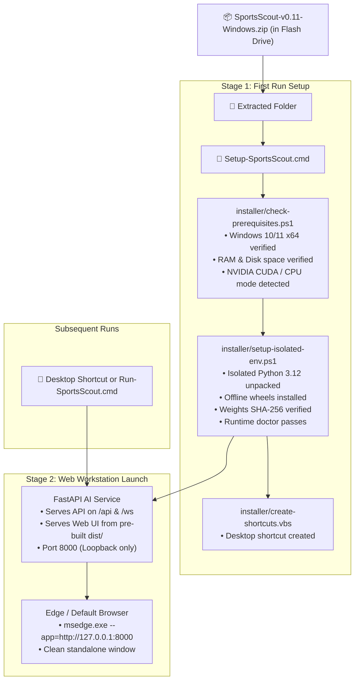

# Implementation Plan: SportsScout Windows 10/11 ZIP & Self-Installer Edition

> **Status:** APPROVED & PLANNED  
> **Target OS:** Windows 10 & Windows 11 (64-bit x64)  
> **Distribution:** Standalone `.zip` archive (Flash Drive / Offline Distribution)  
> **Execution Model:** Two-stage deployment (`Setup-SportsScout.cmd` -> Auto-provisioning -> Auto-launch web app -> Desktop Shortcut)  
> **Engineering Governance:** Strictly adheres to [AGENTS.md](file:///c:/Users/sport/OneDrive/Documents/GitHub/Sports-cout-/AGENTS.md) (One phase at a time, verification gates, zero regressions)

---

## 1. Goal & Architecture Overview

The goal is to deliver a zero-hassle, self-contained distribution package for SportsScout that can be copied onto a standard USB flash drive and executed on any standard Windows 10 or 11 workstation without requiring prior installation of Node.js, Git, or administrative privileges.



### Key Architectural Pillars

1. **Eliminate Node.js Runtime Requirement:**
   - The web frontend is pre-built into production static files (`dist/`) using `npm run build` during package generation.
   - FastAPI in [server.py](file:///c:/Users/sport/OneDrive/Documents/GitHub/Sports-cout-/ai_service/server.py) serves the compiled web assets directly using `StaticFiles` with SPA fallback routing.
   - Target machines need **zero Node.js/npm installations**.

2. **Isolated, Zero-Admin Python Runtime:**
   - Bundles an isolated/embedded CPython 3.12 distribution with pre-downloaded wheels in `payload/wheels/`.
   - Setup operates purely in user-space (local folder or `%LOCALAPPDATA%\SportsScout`), requiring **zero Administrator (UAC) elevation**.
   - Completely decoupled from any system Python or registry keys.

3. **Intelligent Hardware Acceleration & Fallback:**
   - Detects NVIDIA GeForce / RTX GPUs and configures CUDA 12.4 acceleration.
   - If running on Intel / AMD graphics or non-CUDA machines, seamlessly defaults to CPU inference with transparent logging per [PYTHON_RUNTIME.md](file:///c:/Users/sport/OneDrive/Documents/GitHub/Sports-cout-/docs/PYTHON_RUNTIME.md).

4. **Self-Contained Data Management:**
   - User projects, analysis jobs, and exports are organized under `data/` within the folder or portable path, ensuring user data is preserved across app updates.

---

## 2. Package Folder Structure (`.ZIP` Archive)

```
SportsScout-v0.11-Windows/
├── 🚀 Setup-SportsScout.cmd       # First-time setup & auto launch
├── 🏸 Run-SportsScout.cmd         # Quick launcher for daily use
├── 🛑 Stop-SportsScout.cmd        # Clean shutdown script
├── 📖 คู่มือการติดตั้งและใช้งาน.txt   # User guide for coaches and scouts
│
├── installer/
│   ├── check-prerequisites.ps1   # OS, memory, disk, and GPU hardware probe
│   ├── setup-isolated-env.ps1    # Unpacks isolated python & wheels offline
│   └── create-shortcuts.vbs      # Creates desktop & start menu shortcuts
│
├── payload/
│   ├── python-bundle/            # Isolated CPython 3.12 runtime
│   ├── wheels/                   # Offline wheel packages (.whl)
│   ├── web/                      # Compiled frontend assets (dist/)
│   ├── ai_service/               # FastAPI backend codebase
│   └── models/                   # Cryptographically verified model weights
│       ├── yolov8n.pt
│       ├── yolov8n-pose.pt
│       └── rallylens-shuttle-tracknet.pth
│
└── data/
    ├── analysis-jobs/            # Track analysis outputs
    ├── exports/                  # Video and data exports
    └── logs/                     # Diagnostics and runtime logs
```

---

## 3. Phased Implementation Roadmap

### Phase ZIP-1: Web SPA Serving in FastAPI (Eliminating Node.js Dependency)
- **Target Files:**
  - [ai_service/server.py](file:///c:/Users/sport/OneDrive/Documents/GitHub/Sports-cout-/ai_service/server.py): Add static web asset mounting and SPA fallback handler for non-API routes when `SPORTSCOUT_WEB_DIST` is configured.
  - [src/services/aiConnection.ts](file:///c:/Users/sport/OneDrive/Documents/GitHub/Sports-cout-/src/services/aiConnection.ts): Enable same-origin connection detection when hosted on the unified port.
- **Verification Gates:**
  - Unit tests verifying FastAPI serves `index.html` on client-side routes without interfering with `/api` or `/ws`.
  - Frontend TypeScript check (`npm run typecheck`), linting (`npm run lint`), and Vitest (`npm test`).

### Phase ZIP-2: Prerequisite Probe & Isolated Environment Installer
- **Target Files:**
  - `installer/check-prerequisites.ps1`: Automated checks for Windows 10/11 (Build 19041+), disk space (>= 10 GB), RAM (>= 8 GB), and GPU.
  - `installer/setup-isolated-env.ps1`: Script to unpack isolated Python, install offline wheels, verify model SHA-256 hashes, and invoke [runtime_doctor.py](file:///c:/Users/sport/OneDrive/Documents/GitHub/Sports-cout-/ai_service/runtime_doctor.py).
  - `Setup-SportsScout.cmd`: Double-click CMD entrypoint with clear user progress messaging.
- **Verification Gates:**
  - Automated PowerShell test verifying zero-admin execution in non-elevated user contexts.
  - Python runtime doctor exit code 0 under both CUDA and CPU emulation.

### Phase ZIP-3: Launch Orchestration & Desktop Shortcuts
- **Target Files:**
  - `installer/create-shortcuts.vbs`: Non-admin VBScript generating Desktop and Start Menu `.lnk` shortcuts.
  - `Run-SportsScout.cmd`: Checks environment readiness, launches background AI service, polls `/api/status`, and opens Microsoft Edge in App Mode (`msedge.exe --app=http://127.0.0.1:8000`).
  - `Stop-SportsScout.cmd`: Graceful shutdown of the background Python process.
- **Verification Gates:**
  - Verify process lifecycle (clean launch, healthy port detection, clean termination).

### Phase ZIP-4: Automated ZIP Package Generator
- **Target Files:**
  - `scripts/package-zip.ps1`: Automated developer build script that:
    1. Executes verification suite (`typecheck`, `lint`, `test`).
    2. Builds production frontend (`npm run build`).
    3. Stages isolated Python runtime and audited offline wheels.
    4. Copies verified model weights.
    5. Compresses the release payload into `SportsScout-v0.11-Windows.zip`.
    6. Emits `SHA256SUMS.txt` for release integrity validation.
- **Verification Gates:**
  - Complete end-to-end packaging dry run producing a valid `.zip` artifact.

### Phase ZIP-5: Clean-System Validation & Quality Audit
- **Validation Scope:**
  - Test deployment inside an isolated Windows Sandbox instance (completely clean Windows 10/11 with zero dev tools installed).
  - Verify `Setup-SportsScout.cmd` unpacks and launches cleanly.
  - Perform real-video tracking smoke test to certify end-to-end execution.
  - Confirm Desktop shortcut launches within 3-5 seconds on subsequent runs.

---

## 4. Governance & Rules Compliance

- **No Direct Changes to `main`**: Implemented on designated feature branch (`feat/windows-zip-installer`).
- **One Phase at a Time**: Each phase (ZIP-1 through ZIP-5) will run full verification, produce clean test logs, commit with clear semantic messages, and report status before proceeding.
- **Integrity First**: No synthetic tracking data in production stores, no unvalidated biomechanics claims, and strict preservation of real-video tracking accuracy standards.
